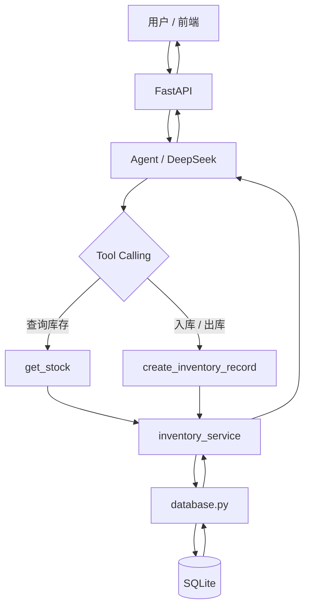

# Inventory AI Agent

基于 FastAPI、SQLite 和 DeepSeek Tool Calling 构建的库存 AI Agent 原型。

用户可以通过自然语言查询库存、发起入库或出库操作。系统由大模型负责理解用户意图和选择工具，实际库存计算、业务校验和数据库写入由 Python 后端完成。

## 核心设计

- FastAPI：提供 HTTP API
- DeepSeek：理解用户意图并进行 Tool Calling
- Tool：执行库存查询和入出库操作
- inventory_service：处理库存业务规则
- database.py：负责 SQL 数据访问
- SQLite：持久化库存数据
- 写操作二次确认：防止模型误操作数据库

## 系统架构

```text
用户请求
↓
FastAPI 接收请求
↓
Agent / DeepSeek 理解用户意图
↓
Tool Calling 选择业务工具
↓
inventory_service 执行业务逻辑
↓
database.py 执行 SQL
↓
SQLite 保存和查询真实数据
↓
结果返回 Agent
↓
DeepSeek 组织自然语言回答
↓
FastAPI 返回给用户
```


### 设计原则

大模型负责自然语言理解和工具选择，确定性的库存计算、业务校验和数据库写入由 Python 代码执行，避免模型直接决定关键业务结果。

## 核心功能

- 自然语言库存查询
- 自然语言入库 / 出库
- DeepSeek Tool Calling 工具选择
- 按物料和单位计算当前库存
- SQLite 数据持久化
- 库存不足拦截
- 非法数据校验
- 写操作二次确认
- 多轮状态管理
- FastAPI 接口与 Swagger 调试

## 技术栈

- Python
- FastAPI
- Pydantic
- SQLite
- SQL
- DeepSeek API
- Tool Calling
- Git / GitHub

## 项目结构

```text
inventory-ai-agent/
├─ main.py
├─ agent.py
├─ inventory_service.py
├─ database.py
├─ tool_test.py
├─ llm_test.py
├─ README.md
└─ .gitignore
```

- `main.py`：FastAPI 接口入口
- `agent.py`：LLM 调用、Tool Calling、写操作确认
- `inventory_service.py`：库存业务逻辑
- `database.py`：SQL 与 SQLite 数据访问
- `tool_test.py`：Tool Calling 测试
- `llm_test.py`：LLM API 连通性测试

## 本地运行

### 1. 安装依赖

```bash
pip install fastapi uvicorn pydantic openai
```

### 2. 配置 DeepSeek API Key

在系统环境变量中设置：

```text
DEEPSEEK_API_KEY=你的_API_KEY
```

请勿将真实 API Key 提交到 GitHub。

### 3. 启动服务

```bash
python -m uvicorn main:app --reload
```

启动成功后访问：

```text
http://127.0.0.1:8000/docs
```

可以通过 Swagger 页面测试库存接口和 Agent 接口。

## 演示示例

### 查询库存

用户输入：

```text
金刚石微粉现在还有多少斤？
```

系统流程：

```text
用户请求
→ FastAPI 接收请求
→ DeepSeek 判断为库存查询
→ 调用 get_stock
→ inventory_service 执行业务逻辑
→ database.py 查询 SQLite
→ Python 计算当前库存
→ DeepSeek 组织自然语言回答
→ FastAPI 返回结果
```

示例结果：

```text
金刚石微粉当前库存为 9 斤。
```

### 入库操作

用户输入：

```text
帮我入库1斤金刚石微粉
```

系统不会立即写入数据库，而是先返回：

```text
确认入库1斤金刚石微粉吗？请回复“确认”或“取消”。
```

用户回复“确认”后，系统才执行数据库写入。

## 当前项目特点

- 将大模型理解能力与确定性业务逻辑分离
- 使用 Tool Calling 进行意图路由和参数提取
- 关键库存计算和数据库操作由 Python 执行
- 对写操作增加二次确认，降低误操作风险
- 使用 SQLite 实现数据持久化
- 通过 FastAPI 暴露 HTTP API，方便前端或其他系统集成

## 当前限制

- 当前 `pending_action` 为单用户内存状态
- 多用户场景需要按用户或 session 管理状态
- SQLite 适合当前原型，正式生产环境可替换为 MySQL 或 PostgreSQL
- 当前主要聚焦库存查询和入出库 Agent 流程

## 后续计划

- 增加更完整的日志和异常处理
- 增加基础自动化测试
- 完成项目部署
- 增加更完善的用户 / session 状态管理
- 根据真实业务需要评估是否增加 RAG 或其他 Agent 能力